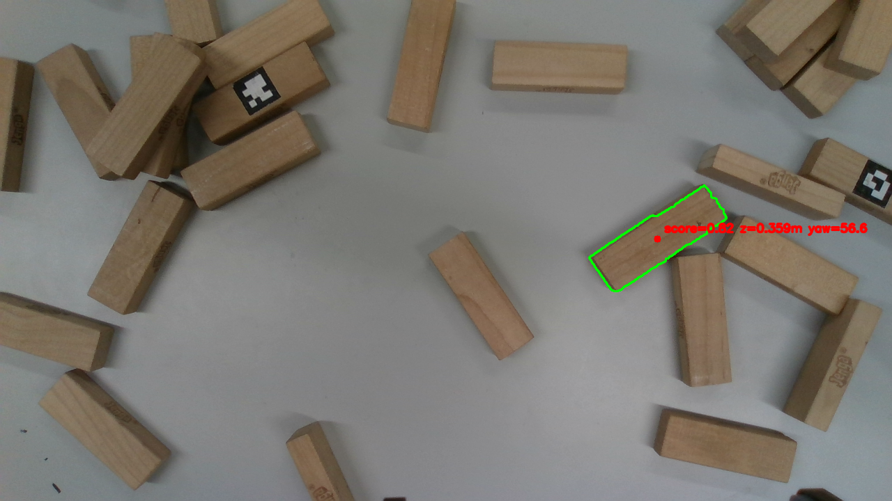

# Jenga Grab — RealSense + OpenCV + xArm

Pick up and stack Jenga blocks with real hardware. An Intel RealSense depth camera
is mounted on the wrist of a UFactory xArm (an **eye-in-hand** setup). OpenCV finds
the best block in the color/depth frame, the camera point is transformed into the
robot base frame, and the xArm drives a gripper through a pick-and-place — or a
continuous stacking — motion.



> The image above is real debug output: blocks on a table, the chosen one outlined in
> green with its score, depth, and gripper-yaw label.

There is no simulator and no mock robot — everything talks to the physical camera and
arm. The tuned, tested configuration is **`config2.json`**; `config.json` is an older
single-grab config and is ignored.

## Requirements

Hardware:

- Intel RealSense depth camera (mounted on the wrist — eye-in-hand), on a USB 3 port.
- UFactory xArm with a gripper.

Software:

- Python **3.11**
- `opencv-python`, `numpy`, `pyrealsense2`, `xArm-Python-SDK` (see `requirements.txt`)

## Installation

```powershell
git clone https://github.com/Pigtot/simple-grab.git
cd simple-grab

python -m venv .venv
.\.venv\Scripts\Activate.ps1        # Windows PowerShell
# source .venv/bin/activate         # macOS/Linux

pip install -r requirements.txt
```

Prefer [uv](https://github.com/astral-sh/uv)? `uv venv && uv pip install -r requirements.txt`.

## Quick start

With the virtual environment activated, run any script with plain `python`. Point it
at the tuned config with `--config config2.json`.

### Live preview stacking (recommended)

Opens a live RealSense window with the detection overlay. Press **`g`** to pick the
shown block and place it on the growing stack; **`q`** or **`Esc`** to quit.

```powershell
python live_stack_grab.py --config config2.json
```

The live stream defaults to 1280×720; the pixel-based vision thresholds are rescaled
automatically. Useful flags:

```powershell
python live_stack_grab.py --config config2.json --width 640 --height 480
python live_stack_grab.py --config config2.json --fast-move-speed 220 --fast-speed-min-clearance-mm 45
```

### Keyboard stacking (no preview window)

Captures one fresh frame each time you type `g` at the prompt; `q` to quit.

```powershell
python stack_grab.py --config config2.json
```

### Single grab (one pick-and-place cycle)

Drag the wrist camera over a block, capture one frame, pick it, and place it at
`grasp.place_xyz_mm`. Add `--yes` to skip the confirmation prompt.

```powershell
python simple_jenga_grab.py --config config2.json
```

### Fixed-camera calibration (only if the camera is NOT on the wrist)

`calibrate.py` solves a fixed camera-to-base transform from point pairs. With the
eye-in-hand config it exits with a warning, so it is not part of the normal flow.

```powershell
python calibrate.py --config config.json
```

## How it works

```text
RealSense frame ──► OpenCV detect ──► camera→robot transform ──► xArm motion
 (color + depth)     (best block)      (eye-in-hand chain)        (pick / stack)
```

1. **Capture** one aligned RealSense color + depth frame and read the camera
   intrinsics and depth scale.
2. **Detect** — `VisionPipeline` segments the frame, scores block-shaped contours,
   picks the best, and back-projects its center pixel + depth into a 3D camera-frame
   point (meters). It also reports a suggested gripper yaw.
3. **Transform** — because the camera rides on the wrist, the camera point is mapped
   to the robot base frame using the current TCP pose and the measured camera mount.
4. **Move** — the xArm runs a 9-step pick-and-place; the stacking scripts compute the
   next slot/layer and add a travel-height clearance between moves.

## Project structure

| File | Role |
| --- | --- |
| `vision_pipeline.py` | OpenCV block detector + pixel/depth → 3D camera point. The vision core. |
| `simple_jenga_grab.py` | Shared library (RealSense capture, xArm helpers, eye-in-hand transform) **plus** a one-shot single-grab `main()`. |
| `stack_grab.py` | Keyboard-driven continuous stacking. |
| `live_stack_grab.py` | **Primary entry point** — live OpenCV preview; press `g` to grab/stack. |
| `calibrate.py` | Fixed-camera point-pair calibration only. Not used in eye-in-hand mode. |
| `config2.json` | **Tuned config** used by the stacking scripts. |
| `config.json` | Legacy single-grab config. Ignored. |
| `grab_debug/` | Debug images written each grab (`color`, `depth_raw`, `mask`, `detection`). |
| `LIVE_STACK_GRAB_README.md` | Line-by-line deep dive on `live_stack_grab.py`. |

## OpenCV skills (`vision_pipeline.py`)

The detector is built to survive uneven lighting on a plain table:

- **Shadow normalization** — BGR→LAB, **CLAHE** on the L channel, then divide by a
  heavily blurred copy (`cv2.divide`) to flatten illumination.
- **Color mask** — **Otsu** thresholds on the LAB *b* channel and HSV saturation,
  combined with `bitwise_or`, to catch the yellow block color.
- **Edge mask** — **Canny** + `dilate` + `morphologyEx(MORPH_CLOSE)`, then fill the
  contours.
- **Watershed** — `distanceTransform` + `connectedComponents` markers feed
  `cv2.watershed` to split blocks that touch.
- **Contour analysis** — `findContours`, `contourArea`, `moments` (center),
  `minAreaRect` (size + angle), `boundingRect` (ROI).
- **Robust depth** — median of valid depth around the center, falling back to the
  median inside an **eroded** contour ROI so background pixels don't skew it.
- **Back-projection** — `x=(u−cx)/fx·z`, `y=(v−cy)/fy·z`, `z=depth` → camera-frame XYZ.
- **Scoring** — a weighted blend of fill ratio, aspect ratio, size, and
  yellow/saturation, each shaped with a Gaussian around the expected block geometry.
- **Yaw** — the `minAreaRect` long-axis angle, normalized to `[-90, 90)`.

## Camera skills (`pyrealsense2`)

- Configure an `rs.pipeline` with a **z16 depth** and **bgr8 color** stream.
- **`rs.align(rs.stream.color)`** so each depth pixel lines up with its color pixel.
- Discard **warmup frames** for auto-exposure, with timeout + retry on
  `wait_for_frames`.
- Pull **intrinsics** (`fx, fy, ppx, ppy`) and the **depth scale** (m per raw unit).
- Two capture styles: one-shot `capture_realsense_frame()` and a continuous
  `RealSenseLiveStream` that keeps the stream open for the live preview.
- `prepare_live_config()` rescales pixel thresholds when the preview runs at higher
  resolution than the capture config.

## Calibration skills

**Eye-in-hand manual (the mode used here).** The camera moves with the robot, so a
single fixed transform isn't valid. The point is mapped through:

```text
point_base = T_base_from_tcp_current @ T_tcp_from_camera @ point_camera
```

- `T_tcp_from_camera` is the **measured** mount: `camera_origin_in_tcp_mm` plus
  `camera_axes_to_tcp_rpy_deg` (rotation built with `Rz(yaw) @ Ry(pitch) @ Rx(roll)`).
  Set `verified: true` once measured, or the script refuses to run.
- `T_base_from_tcp_current` is the live TCP pose read at the moment of capture.

The pick yaw is computed separately:
`pick_yaw = capture_yaw − vision_yaw + yaw_offset_deg + wrist_grasp_offset`
(`wrist_grasp_offset` is 90° for `grab_from_side: "long"`, 0° for `"short"`).

**Fixed-camera point pairs (`calibrate.py`, secondary).** For a world-fixed camera it
collects `(camera_m, robot_mm)` pairs and solves a rigid transform
`robot = R @ camera + t` with an **SVD / Kabsch** fit, reporting per-point errors.

## Robot / motion skills (xArm SDK)

- Connect with `XArmAPI`; switch between **position mode** (`set_mode(0)`) and **joint
  teaching mode** (`set_mode(2)`) for drag-to-teach posing.
- `set_collision_sensitivity` and `set_tcp_load` for safety; gripper control via
  `set_gripper_*`.
- Cartesian moves via `set_position(x, y, z, roll, pitch, yaw, speed, wait)`.
- **Safe-range box check** — every pick/place target must fall inside `safe_range`.
- **Travel clearance** — lift above the pick, place, stack top, and `robot.safe_z_mm`
  before moving across.
- **Stacking math** — two blocks per layer (offset by `block_width_mm`), each new
  layer raised by `block_height_mm` and rotated 90°.

## Configuration (`config2.json`)

| Section | Key fields |
| --- | --- |
| `robot` | `ip`, `safe_z_mm`, `move_speed`, `approach_speed`, `collision_sensitivity`, `tcp_load_kg`, `tcp_load_center_mm` |
| `gripper` | `open_position`, `close_position`, `speed` |
| `camera` | `width`, `height`, `fps`, `warmup_frames` |
| `vision` | `min_score`, `min_depth_m`, `max_depth_m`, `edge_margin_px`, `min_area_px` |
| `calibration` | `setup: eye_in_hand_manual`, `yaw_offset_deg`, `eye_in_hand_manual.{verified, camera_origin_in_tcp_mm, camera_axes_to_tcp_rpy_deg}` |
| `grasp` | `place_xyz_mm` (stack base), `initial_scan_pose_mm_deg`, `place_yaw_deg`, `grab_from_side`, `pick_z_offset_mm`, `drag_to_view_before_capture` |
| `safe_range` | `x/y/z_min`, `x/y/z_max` (the allowed motion box) |

Notes:

- `config2.json` omits block dimensions, so the code defaults to **length 75 /
  width 25 / height 15 mm**.
- `grasp.stack_step_z_mm` is present but **not read** by the code — the per-layer
  height step comes from `block_height_mm`. Treat it as informational.

## Safety

- Keep the emergency stop within reach.
- Confirm `safe_range` and `initial_scan_pose_mm_deg` before any motion.
- Keep `eye_in_hand_manual.verified: true` only when the mount values are correct and
  the camera hasn't moved.
- Start at modest speeds; raise `--fast-move-speed` only after the basics work.

## Debug images

Each grab writes to `grab_debug/`: `color.png`, `depth_raw.png`, `mask.png`,
`detection.png`, plus numbered copies (`detection_001.png`, …). Check these if the
robot misses or chooses the wrong block.

## Further reading

[`LIVE_STACK_GRAB_README.md`](LIVE_STACK_GRAB_README.md) — a line-by-line walkthrough
of the live runner and a config-tuning guide (what to change when X/Y, Z, yaw,
stacking, detection, or speed look wrong).
